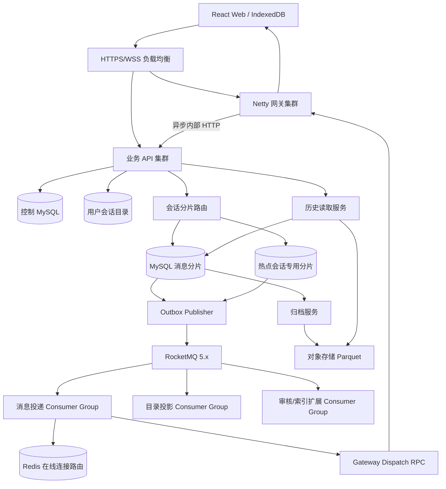

# Web IM 系统需求与技术设计

版本：1.0  
日期：2026-10-17  
状态：开发基线  
技术路线：Java 21、Spring Boot、Netty、MySQL 8.4 LTS、Redis、RocketMQ 5.x、React

## 1. 文档目的

本文定义一个面向真实生产环境的 Web IM 产品，从产品范围、容量指标、可靠性语义，到 MySQL 分片、RocketMQ、Netty 网关、历史归档、部署、开发计划和压测验收。

系统的首期目标是：

- 1000 人同时在线，最多 3000 条 WebSocket 连接。
- 常态接收 3000 条用户消息/秒。
- 峰值接收 9000 条用户消息/秒，持续 15 分钟。
- 按平均每条消息投递 20 个在线设备规划，常态 60000、峰值 180000 次设备投递/秒。
- 单聊和最多 200 人的普通群聊。
- 消息先可靠落库，再异步通知；断线后可以完整恢复。
- 数据库、MQ、Worker 和网关可以分别扩容。

这里的“输入消息”不包含心跳、已读回执、同步查询和发送重试。压测时必须额外加入这些辅助负载。

## 2. 产品需求

### 2.1 用户与使用场景

主要角色：

- 普通用户：通过浏览器进行单聊、群聊、发送附件和查看历史。
- 群主或管理员：创建群、管理成员、解散群。
- 运营管理员：处理举报、封禁用户和查看审计记录。
- 运维人员：发布服务、扩容、迁移分片、恢复数据和处理 RocketMQ 积压。

### 2.2 首版功能范围

#### 账号和安全

- 用户注册、登录、刷新登录态和退出。
- 同一用户多设备登录。
- 设备会话查询和撤销。
- 用户封禁和强制失效已有登录态。
- 好友申请、接受、拒绝、删除和拉黑。

#### 单聊和群聊

- 两名用户之间只有一个有效单聊会话。
- 创建群聊，群成员上限 200 人。
- 邀请、移除、主动退群、设置管理员和解散群。
- 群成员只能读取其当前成员区间内允许访问的消息。
- 退群后禁止继续读取该群历史和附件；重新加入不恢复以前的历史权限。

#### 消息

- 文本、图片和普通文件消息。
- 文本最多 8 KiB UTF-8。
- 图片最多 10 MiB，文件最多 20 MiB。
- 发送中、成功、失败三类发送状态。
- 发送成功后返回服务端消息 ID、会话序号和服务端时间。
- 离线恢复、缺口补拉、重复消息去重和多端同步。
- 单聊显示对方已读；普通群首版只展示本人未读，不提供逐成员已读列表。

#### 历史和附件

- 按会话序号游标向前、向后分页。
- MySQL 保存最近 7 个完整 UTC 日及当天的热消息。
- 对象存储保存第 8～180 天的归档消息。
- 文件默认保存 90 天，到期后历史记录保留“附件已过期”状态。
- 浏览器不能直接访问完整归档文件，只能调用授权历史接口。

#### 运营能力

- 举报消息。
- 封禁用户。
- 查看管理员操作审计。
- 查询消息投递、积压和同步异常，不展示用户密码、令牌等机密信息。

### 2.3 不在首版范围

- 音视频通话。
- 万人群和公开频道。
- 消息编辑、反应、线程回复。
- 全文搜索。
- 端到端加密。
- 跨地域多主写入。
- 单个会话每秒数千条消息。

### 2.4 容量和服务指标

| 指标 | 常态目标 | 峰值目标 |
|---|---:|---:|
| 消息输入 | 3000 条/秒 | 9000 条/秒，15 分钟 |
| 设备投递 | 60000 次/秒 | 180000 次/秒 |
| 发送 ACK | p95≤200ms，p99≤500ms | p99≤1s |
| 在线接收端落地 | p95≤500ms，p99≤1s | p99≤2s |
| 合法请求处理成功率 | ≥99.9% | ≥99.9% |
| 单会话持续输入 | ≤50 条/秒 | 突发≤100 条/秒 |
| WebSocket 连接 | 最多 3000 | 最多 3000 |
| 月度可用性 | 99.9% 运营目标 | — |

容量指标必须在完整可靠性配置、正式 TLS、接近生产的数据规模下验证。不得通过拒绝合法请求、缩小消息体或关闭副本来宣称达标。

### 2.5 可靠性语义

系统不承诺跨网络“恰好一次”，采用以下语义：

- `SEND_ACK`：消息、幂等记录和 Outbox 已在同一 MySQL 分片事务提交。
- RocketMQ 事件：至少一次发布和至少一次消费，允许重复。
- 在线通知：加速通道，允许因网关重启或连接变化而丢失。
- 客户端：消息写入 IndexedDB 后才发送设备接收确认。
- 已读：用户实际看到消息后，按会话单调推进。
- 断线恢复：客户端根据连续会话序号从 MySQL 或归档补齐。

收到发送 ACK 的消息必须能够从权威存储恢复。没有收到 ACK 的请求可能已经提交，客户端必须使用原 `clientMsgId` 查询或重试。

## 3. 总体架构



##### 3.1 组件职责

| 组件 | 职责 |
|---|---|
| Web 客户端 | IndexedDB、本地待发队列、消息去重、补洞、虚拟列表 |
| Netty 网关 | WebSocket、认证、心跳、限流、背压、推送 |
| 业务 API | 账号、好友、群、发送事务、历史、已读、附件授权 |
| 路由控制面 | 1024 槽映射、会话覆盖路由、迁移状态与 epoch |
| MySQL 消息分片 | 会话、成员、消息、幂等、附件、Outbox |
| Outbox Publisher | 领取事件、发送 RocketMQ、更新发布状态 |
| RocketMQ | 已提交业务事件、消费进度、重试、短期回放和削峰 |
| 投递 Worker | 读取正文与成员，查询在线路由，按网关聚合投递 |
| 目录投影 Worker | 构建按用户查询的会话目录 |
| Redis | 在线用户到网关连接的可重建路由 |
| 归档服务 | 导出、校验、发布 Parquet 和清理热分区 |
| 历史读取服务 | 合并 MySQL 热数据和对象存储冷数据 |

正常发送路径不逐条查询控制库：路由和授权信息缓存在应用实例中，最终由目标分片的 epoch 和写入栅栏保证正确性。

## 4. 核心技术选型

| 层次 | 选择 |
|---|---|
| Web | React、TypeScript、Vite、IndexedDB |
| HTTP | Java 21 LTS、Spring Boot、Spring Security |
| WebSocket | Netty NIO |
| 数据访问 | MyBatis、HikariCP、Flyway |
| 数据库 | MySQL 8.4 LTS、InnoDB、托管高可用 |
| 在线路由 | Redis 高可用 |
| 事件总线 | RocketMQ 5.x，Controller 自动切换模式 |
| 文件与历史 | 私有对象存储、Parquet＋ZSTD |
| 观测 | Micrometer、Prometheus、Grafana、OpenTelemetry、集中日志 |
| 测试 | JUnit、Testcontainers、Playwright、k6、自研一致性校验器 |

选择 RocketMQ 的依据：

- 3000/9000 条每秒的持久业务事件可以按 Topic 队列横向分散。
- 消费组适合投递、目录、审核、搜索等多个独立消费者。
- 消费位点便于故障恢复和保留期内回放。
- FIFO MessageGroup 可以约束需要顺序处理的会话事件。
- 更适合未来存在百万级积压、多业务订阅的事件基础设施。

RocketMQ 不负责正式消息顺序和永久历史；这两项仍由 MySQL 会话序号及历史存储负责。

## 5. MySQL 分片和数据模型

### 5.1 数据所有权

- 控制库：用户、登录会话、好友、拉黑、路由和迁移任务。
- 消息分片：会话、成员、消息、幂等、附件和 Outbox。
- 用户目录：按用户发现会话的最终一致投影。
- Redis：在线连接位置，可重建。
- 对象存储：附件和冷历史。

同一会话的所有权威消息数据必须位于同一个 MySQL 实例，发送事务不跨库。

### 5.2 路由

```text
conversation_routes[conversationId] 存在
    → 使用会话专用路由
否则
    → slot = xxHash64(UUID原始16字节, seed=0) % 1024
    → slot_routes[slot]
```

路由结果包含：

```text
shardId + tableGroup + routeEpoch + state
```

初始使用 1024 个固定逻辑槽、4 个物理 MySQL 分片、每分片 8 个表组。扩容通过迁移逻辑槽或单个热点会话完成，不改变哈希槽总数。

单聊会话 ID 根据固定命名空间和排序后的两名用户 UUID 确定性生成，避免并发创建出多个单聊及跨分片冲突。群聊使用 UUIDv7。

### 5.3 建表文件

- 控制库及用户目录：[001_control_schema.sql](../sql/001_control_schema.sql)
- 消息分片表组模板：[002_message_shard_schema.sql](../sql/002_message_shard_schema.sql)

实现时由 Flyway 生成并维护 `00～07` 八个表组。SQL 中 `messages_00` 的日期分区只是初始化样例；分区管理任务每天提前创建未来七天分区，任何数据进入 `p_future` 都应告警。

MySQL 的分区键必须包含在所有唯一键中，且分区 InnoDB 表不能使用外键，因此幂等记录单独存储，消息分片表通过应用事务和对账保证引用完整性。

### 5.4 幂等表代际

每天 2.592 亿条消息意味着幂等记录不能长期逐行删除。采用六小时一代的幂等表：

```text
generation = floor(clientMsgId中的UUIDv7时间戳毫秒 / 21600000)
send_dedup_{tableGroup}_g{generation}
```

规则：

- 客户端自动重试窗口为 24 小时。
- 保留覆盖 24 小时的代际和一小时清理余量。
- 请求时间超前服务端五分钟或落后超过 24 小时，先查幂等；不存在则拒绝自动发送。
- 事务对代际注册行加共享锁，清理器加排他锁并关闭代际后才允许删除整表。
- 动态表名只能由服务端白名单生成。
- 缺少目标代际表时拒绝发送并告警，不能绕过幂等。

### 5.5 用户会话目录

目录只负责发现会话：

- 成员事件携带单调递增 `membershipVersion`。
- 仅应用版本更高的事件，重复和乱序不会恢复已退出成员。
- 每条群消息不更新所有成员目录；活跃度更新按用户、会话合并。
- 会话列表先查目录，再按物理分片分组批量查询高水位。
- 最终消息权限仍由会话分片判断。

## 6. 消息发送事务

### 6.1 发送前处理

1. 从认证上下文获取发送人，忽略客户端身份字段。
2. 校验文本、消息类型、附件数量、用户和会话限流。
3. 根据会话取得目标分片和路由 epoch。
4. 检查账号、好友、拉黑授权；授权缓存最长五秒。
5. 解析 UUIDv7 `clientMsgId`，定位固定幂等代际。
6. 规范化会话、类型、内容和附件列表，计算 SHA-256 `requestHash`。
7. 主库查询幂等结果：哈希相同返回原 ACK，不同返回 `IDEMPOTENCY_CONFLICT`。

好友和拉黑位于控制库，不使用 XA。授权缓存过期且控制库不可用时拒绝发送。产品语义明确为关系和封禁变更最多五秒生效。

### 6.2 锁顺序

```text
幂等代际共享锁
→ 槽栅栏共享锁
→ 会话行排他锁
→ 附件按ID升序排他锁
```

群成员修改也先锁同一会话行，因此发送与退群之间形成明确顺序。事务中禁止调用 Redis、RocketMQ、对象存储或其他远程服务。

### 6.3 事务伪 SQL

```sql
SET TRANSACTION ISOLATION LEVEL READ COMMITTED;
START TRANSACTION;

SELECT state, accept_until
FROM dedup_generations
WHERE generation = :generation
FOR SHARE;

SELECT route_epoch, writable
FROM slot_fences
WHERE slot_id = :slotId
FOR SHARE;

SELECT route_epoch, write_state, status, type,
       last_seq, last_message_at
FROM conversations_00
WHERE id = :conversationId
FOR UPDATE;

SELECT request_hash, message_id, seq, message_day, created_at
FROM send_dedup_00_gNNN
WHERE conversation_id = :conversationId
  AND sender_id = :senderId
  AND client_msg_id = :clientMsgId;

SELECT status, joined_seq
FROM members_00
WHERE conversation_id = :conversationId
  AND user_id = :senderId;

-- 附件消息按ID升序SELECT ... FOR UPDATE。
-- newSeq = lastSeq + 1。
-- serverTime取数据库UTC时间且不得早于lastMessageAt。

UPDATE conversations_00
SET last_seq = :newSeq,
    last_message_at = :serverTime,
    updated_at = :serverTime
WHERE id = :conversationId;

INSERT INTO messages_00 (
    conversation_id, message_day, seq, slot_id,
    message_id, sender_id, client_msg_id,
    type, content, created_at
) VALUES (
    :conversationId, :messageDay, :newSeq, :slotId,
    :messageId, :senderId, :clientMsgId,
    :type, :content, :serverTime
);

INSERT INTO send_dedup_00_gNNN (
    conversation_id, sender_id, client_msg_id, slot_id,
    request_hash, message_id, seq, message_day, created_at
) VALUES (
    :conversationId, :senderId, :clientMsgId, :slotId,
    :requestHash, :messageId, :newSeq, :messageDay, :serverTime
);

INSERT INTO outbox_00 (
    event_id, event_type, schema_version, slot_id,
    conversation_id, message_day, message_seq,
    payload, status, available_at, created_at
) VALUES (
    :eventId, 'MESSAGE_CREATED', 1, :slotId,
    :conversationId, :messageDay, :newSeq,
    JSON_OBJECT('messageId', :messageIdText),
    0, :serverTime, :serverTime
);

COMMIT;
```

只有 `COMMIT` 成功后才能返回 `SEND_ACK`。

### 6.4 失败处理

| 故障 | 行为 |
|---|---|
| 死锁或锁超时 | 回滚整个事务，随机退避，最多额外重试两次 |
| 提交时连接中断 | 结果未知，使用原 ID 查主库或重试 |
| 幂等 ID 携带不同内容 | 明确拒绝，不覆盖原消息 |
| 路由 epoch 过期 | 回滚、刷新路由并有限重试 |
| MySQL 不可用 | 拒绝新发送，不返回成功 ACK |
| RocketMQ 不可用 | 不影响已提交消息 ACK，Outbox 保留并补发 |
| Outbox 接近磁盘安全线 | 主动限流、告警，保护数据库 |

## 7. RocketMQ 技术方案

### 7.1 Topic 与消费组

| Topic | 队列数 | MessageGroup/ShardingKey | 消费组 |
|---|---:|---|---|
| `im-message-events` | 64 | conversationId | `cg-im-delivery` |
| `im-membership-events` | 32 | conversationId | `cg-im-directory`、`cg-im-audit` |
| `im-notification-retry` | 32 | conversationId | `cg-im-delivery-retry` |

事件只携带定位信息和必要元数据，不携带附件二进制：

```json
{
  "eventId": "UUID",
  "eventType": "MESSAGE_CREATED",
  "schemaVersion": 1,
  "conversationId": "UUID",
  "seq": "12345",
  "messageDay": "2026-10-17",
  "occurredAt": "2026-10-17T10:00:00.123Z",
  "traceId": "..."
}
```

正式会话顺序由 MySQL `seq` 决定。RocketMQ FIFO 用于减少同会话事件乱序，不作为正确性的唯一依据；消费者仍需按事件 ID 幂等、按版本或序号拒绝旧状态。

### 7.2 Outbox 发布

1. 每个消息分片至少运行两个可接管的发布器实例。
2. 使用 `SELECT ... FOR UPDATE SKIP LOCKED LIMIT 200` 短事务领取事件。
3. 设置 30 秒租约并提交。
4. 事务外批量、异步发送 RocketMQ。
5. 发送成功后按 `id + leaseOwner + status` 条件批量标记已发布。
6. 失败按 1 秒、5 秒、30 秒、2 分钟、10 分钟退避。
7. 达到重试上限后标记人工处理并告警。
8. 已发布 Outbox 保留一小时后小批清理；未发布事件不得按时间删除。

发布成功但更新 Outbox 前崩溃会造成重复事件，这是预期行为。

### 7.3 消费与在线投递

投递 Worker：

1. 消费消息事件并按 `eventId` 做幂等处理。
2. 使用当前路由批量读取消息正文；消息已归档时通过统一历史读取器读取。
3. 查询当前成员及消息可见区间。
4. 批量查询 Redis 在线连接。
5. 按网关合并为“一份正文＋目标 connectionId 列表”。
6. 通过内部 gRPC 长连接把投递批次发给网关。
7. 网关接受批次后返回应用级确认，Worker 再确认 RocketMQ 消费。

网关接受批次不表示客户端已经落地。网关或客户端失败由会话同步恢复，所以不为每个设备建立 RocketMQ 队列。

同一事件重复消费时可以重复在线推送；客户端通过 `messageId` 去重。

### 7.4 RocketMQ 高可用部署

生产使用 RocketMQ 5.x Controller 自动主从切换模式：

- 3 个 NameServer。
- 3 个 Controller，组成 Raft 多数派；可独立部署或嵌入不同 NameServer，生产优先独立资源配额。
- 至少 3 组 Broker，每组 1 Master＋2 Replica，分布在三个可用区。
- Proxy 至少 4 个无状态实例，跨可用区部署。
- 禁止选举不在 SyncStateSet 中的副本：`enableElectUncleanMaster=false`。
- `minInSyncReplicas` 初值为 2，副本不足时拒绝需要可靠写入的消息。
- 是否启用 `allAckInSyncStateSet` 和同步刷盘，由相同硬件下的可靠性压测确定；生产配置和测试报告必须记录最终选择。
- Broker 和 Controller 使用独立 SSD，监控磁盘使用、复制滞后和 SyncStateSet 变化。

选择托管 RocketMQ 时，必须向供应商确认发送成功条件、复制模式、自动切换、保留期、流控和 RPO，不能只依据“高可用版”名称。

### 7.5 保留、积压和回放

- 业务事件默认保留 72 小时，最终值按磁盘成本和恢复目标确定。
- 消费积压超过 30 秒告警，超过 5 分钟升级告警。
- 容量至少验证峰值停止消费 30 分钟产生的 1620 万条事件。
- 恢复时同时测量旧积压消费速度和新消息 p99 延迟。
- 人工回放必须使用独立消费组或受控重置位点，并记录审计。
- MQ 保留期不能代替 MySQL 与对象存储历史。

## 8. Netty 网关与客户端

### 8.1 网关配置起点

| 参数 | 初始值 |
|---|---:|
| 单实例资源 | 8 vCPU、16 GiB |
| Boss/EventLoop | 1/8 |
| 心跳 | 25 秒 |
| 无有效活动断开 | 75 秒 |
| WebSocket 帧上限 | 64 KiB |
| 写缓冲低/高水位 | 32/128 KiB |
| 单连接待发上限 | 256 KiB |
| 单连接写入在途 | 16 |
| 网关业务请求在途 | 1024 |
| 内部 HTTP 超时 | 2 秒 |

EventLoop 只执行协议解析、轻量校验和异步网络 I/O。禁止 JDBC、同步 Redis/MQ、文件 I/O、阻塞锁、`sleep`、`Future.get/join`。

慢连接持续 10 秒不可写或超过待发上限时关闭，由补拉恢复。测试环境开启 Netty 泄漏检测。

### 8.2 在线连接路由

Redis 保存：

```text
userId + deviceId + connectionId + gatewayBootId + leaseExpiry
```

- 连接租约 90 秒，每 30 秒续期。
- 关闭连接时按 connectionId 条件删除，防止旧连接清除新连接。
- 网关重启采用新的 bootId，过期路由自动失效。
- Redis 故障只影响在线加速，不影响消息落库和历史恢复。

### 8.3 WebSocket 协议

```json
{
  "v": 1,
  "op": "SEND",
  "requestId": "UUID",
  "data": {
    "conversationId": "UUID",
    "clientMsgId": "UUIDv7",
    "type": "TEXT",
    "content": {"text": "你好"}
  }
}
```

操作包括：

```text
SEND / SEND_ACK / MESSAGE / RECEIVED_ACK
READ / READ_UPDATE / PING / PONG / ERROR / RECONNECT
```

错误响应包含稳定错误码、`retryable` 和可选 `retryAfterMs`。

### 8.4 浏览器性能

峰值平均每连接每秒约 60 条投递，浏览器必须参与容量验收：

- 接收、IndexedDB 写入和 React 渲染解耦。
- IndexedDB 按 20～50ms 或固定条数批量提交。
- 虚拟列表只渲染可见区域。
- 非当前会话只更新高水位和未读，不创建消息 DOM。
- 本地只保存有界热窗口，冷历史按需查询。
- 首次连接、重连、页面恢复可见时对账；在线每 30 秒带随机抖动对账。
- 同浏览器多标签优先使用 SharedWorker 或 BroadcastChannel 复用连接，但服务端仍支持多连接。

## 9. 历史归档

按平均每条消息连同索引约 2 KiB 粗估：

| 时间 | 逻辑数据量 |
|---|---:|
| 1 天 | 约 494 GiB |
| 7 天 | 约 3.38 TiB |
| 30 天 | 约 14.5 TiB |
| 180 天 | 约 87 TiB |

实际容量需要用真实消息分布测量，另外计算副本、binlog、备份、幂等和 Outbox。

归档文件：

```text
archive/v1/slot=0231/day=2026-10-17/generation=1/part-0001.parquet
```

- Parquet＋ZSTD，目标文件 128～256 MiB。
- 文件内按 `conversationId, seq` 排序。
- 清单保存每个会话的序号范围和 row group。
- 状态机：PREPARING→UPLOADED→VERIFIED→PUBLISHED→HOT_DROPPED。
- 校验行数、SHA-256、序号范围和抽样内容后才能发布。
- 发布清单后才能删除 MySQL 热分区。
- 归档与同一槽迁移互斥。
- 对象不可覆盖，修复使用新 generation。

冷热查询合并后按消息 ID 去重、按序号排序。热历史第一页 p95≤300ms，冷历史第一页 p95≤3s。

## 10. 分片迁移

状态机：

```text
CREATED → COPYING → CATCHING_UP → FREEZING
→ SWITCHING → VERIFYING → COMPLETED
```

流程：

1. 在目标分片创建表组、日期分区和所需幂等代际。
2. 对槽或会话执行一致性快照复制。
3. 使用托管迁移工具或经过验证的 binlog CDC 追平。
4. 暂停同范围的归档、清理和 Outbox 状态修改。
5. 冻结源写入，等待在途事务退出。
6. CDC 到达最终位点，校验行数、高水位和摘要。
7. 目标启用新 epoch，控制库使用 CAS 切换路由。
8. 失效应用路由缓存，客户端使用原幂等 ID 重试。
9. 源保留只读至少 24 小时，验证后清理。

切换后已有新写入时禁止直接回切，必须反向追平或前向修复。槽迁移不包含已配置独立覆盖路由的热点会话。

## 11. 部署基线

以下是 PoC 与初次生产压测的起点，不是容量承诺：

| 组件 | 起始配置 |
|---|---|
| Netty 网关 | 6×8 vCPU/16 GiB，三个可用区各两台 |
| 业务 API | 4×8 vCPU/16 GiB |
| 投递 Worker | 8×4 vCPU/8 GiB |
| 目录及其他 Worker | 按消费组独立 2～4 实例 |
| 控制 MySQL | 托管高可用，4～8 vCPU/16～32 GiB |
| 消息 MySQL | 4 个高可用分片，每主实例从 16 vCPU/64 GiB 起测 |
| RocketMQ NameServer | 3 个 |
| RocketMQ Controller | 3 个 |
| RocketMQ Broker | 3 组，每组 3 副本 |
| RocketMQ Proxy | 至少 4 个 |
| Redis | 托管高可用，8 GiB 起测 |
| 归档/历史 | 独立实例和并发预算 |

平均每次投递 1 KiB 时，峰值纯载荷约 1.47 Gbps，另计 TLS、协议、重传和冗余。六个网关失去一个可用区后，剩余四个实例仍需通过目标峰值验收。

MySQL 基线：

```ini
transaction_isolation=READ-COMMITTED
innodb_flush_log_at_trx_commit=1
sync_binlog=1
binlog_format=ROW
```

发送、幂等、成员权限和同步高水位走主库。归档可读取指定副本，但必须校验复制位点。

## 12. 安全、监控和灾备

### 12.1 安全

- 全链路 HTTPS/WSS，基础设施使用私网。
- 密码使用 Argon2id。
- Refresh Token 哈希入库，Secure、HttpOnly Cookie，支持轮换和撤销。
- WebSocket 使用短时一次性票据并校验 Origin。
- 所有发送、历史和附件下载执行对象级授权。
- 上传直达私有对象存储，完成后校验大小、真实类型和内容状态。
- 用户文本按纯文本渲染，防止 XSS。
- 日志不记录密码、令牌、连接票据和消息正文。
- 管理操作进入审计日志。

### 12.2 监控

必须监控：

- 连接数、建连失败、心跳超时、重连率。
- 输入 TPS、设备投递 TPS、字节吞吐和端到端延迟。
- EventLoop 延迟、不可写连接、网关缓冲和拒绝数。
- 每槽和每分片的事务耗时、锁等待、死锁、连接池和磁盘增长。
- Outbox 最老事件、净增长、发布失败和清理速度。
- RocketMQ 发送延迟、消费 Lag、消费 TPS、重试、死信、复制状态和 SyncStateSet。
- 客户端补洞、重试、IndexedDB 落地延迟和页面卡顿。
- 归档滞后、校验失败、对象读取延迟和预计磁盘耗尽时间。

### 12.3 灾备

- MySQL 启用 PITR，首发前完成真实恢复。
- 应用单实例故障不应丢失已 ACK 的 MySQL 消息。
- MySQL 主库切换 RPO 以托管复制模式和实测为准。
- RocketMQ Broker、Controller 和可用区故障分别演练。
- 单地域灾难通过备份恢复，目标 RPO≤15 分钟、RTO≤4 小时，最终值以供应商能力和演练为准。
- 归档清单在对象存储保留副本，可以重建在线索引。

## 13. 从 0 到 1 开发计划

按两名有相关经验的开发者估算 22～28 周；数据库、RocketMQ 和云基础设施需有专项评审。

### 阶段一：容量 PoC，第 1～3 周

- 执行建表 SQL。
- 实现单表组发送事务、幂等和 Outbox。
- 接入 RocketMQ 发送、消费和失败重试。
- 实现模拟网关投递。
- 压测单分片 2250 条/秒峰值及分片倾斜。
- 测量每条消息、幂等、Outbox 和 binlog 的真实空间。
- 测试 1620 万事件积压恢复。

门槛：写入、清理和消费没有持续净积压，形成资源及成本报告。

### 阶段二：工程与控制面，第 4～6 周

- 后端、前端工程和 CI。
- Flyway 管理控制库、分片和八个表组。
- 1024 槽、路由缓存、epoch 和栅栏。
- 注册、登录、会话撤销。
- 用户目录和统一观测。

门槛：新环境可复现；旧 epoch 无法写入。

### 阶段三：可靠消息闭环，第 7～10 周

- Netty 认证、心跳、协议和限流。
- 完整发送事务和提交后 ACK。
- Outbox Publisher。
- RocketMQ Topic、消费组和 Worker。
- Redis 在线路由和网关 gRPC Dispatch。
- Web IndexedDB 待发、落地和去重。

门槛：丢 ACK、重复请求和进程崩溃后只有一个业务结果；跨网关聊天成功。

### 阶段四：产品功能，第 11～14 周

- 好友、拉黑、群管理、多端和已读。
- 历史补拉和会话高水位对账。
- 附件上传、校验、绑定和下载授权。
- 举报、封禁和管理后台。
- 浏览器高频消息渲染优化。

门槛：成员边界和附件权限正确；真实浏览器高频接收时仍可交互。

### 阶段五：生命周期，第 15～18 周

- 消息日分区管理。
- 六小时幂等代际。
- Parquet 归档和清单。
- 冷热统一查询。
- Outbox、幂等、附件和消息清理。

门槛：清理长期追上输入；归档失败不会删除未验证数据。

### 阶段六：高可用与迁移，第 19～21 周

- 多可用区部署。
- RocketMQ Controller 切换和 Broker 故障演练。
- 槽迁移和单会话迁移。
- 网关连接排空、MySQL 切换和备份恢复。

门槛：旧路由无法脏写，迁移与恢复步骤可重复执行。

### 阶段七：全量压测和灰度，第 22～28 周

- 装载接近七天热数据规模的数据。
- 执行常态、峰值、长稳、积压和故障测试。
- 调整实例、连接池、Topic 队列数和消费并发。
- 输出容量、正确性和成本报告。
- 内部用户→50 人→200 人→目标规模逐步开放。

## 14. 压测验收清单

| 场景 | 负载 | 验收重点 |
|---|---|---|
| 连接爬坡 | 1000→2000→3000 | 心跳稳定，无持续内存增长 |
| 常态 | 3000 输入/秒、60000 投递/秒，2 小时 | 延迟、成功率，无净积压 |
| 峰值 | 9000 输入/秒、180000 投递/秒，15 分钟 | 不靠限流规避目标 |
| 长稳 | 常态 24 小时 | GC、归档、清理和 Lag 稳定 |
| 热点会话 | 200 人群，50 输入/秒 | 序号正确，其他会话稳定 |
| 分片倾斜 | 单分片承受更高比例 | 热点可识别、隔离和迁移 |
| RocketMQ 积压 | 峰值停消费 30 分钟 | 1620 万事件可恢复，新消息延迟受控 |
| Broker 故障 | 发送和消费中停节点 | 自动切换，结果符合副本承诺 |
| Controller 故障 | 失去一个 Controller | 多数派可选主，业务按预期运行 |
| 网关可用区故障 | 同时失去两个网关 | 剩余四个承载峰值 |
| 重连风暴 | 3000 连接在 60 秒恢复 | 认证和补拉不击穿 MySQL |
| 慢客户端 | 部分连接限速或停止读取 | 缓冲有界，其他连接正常 |
| 真实浏览器 | 多会话持续高频接收 | IndexedDB、内存和 UI 可用 |
| 幂等 | 同 ID 并发、丢 ACK、内容冲突 | 一个结果，冲突明确拒绝 |
| 代际边界 | 六小时切换和过期请求 | 不漏查、不重复写 |
| 成员竞争 | 发送与退群、解散并发 | 权限按事务顺序生效 |
| MySQL 切换 | 写入期间切换主库 | 未知结果可查，RPO 符合承诺 |
| 槽/会话迁移 | 持续发送中切换 | 无双写、无重复序号 |
| 归档故障 | 上传、发布、清理分别中断 | 未验证数据不删除 |
| 冷热边界 | 跨边界分页和长期离线 | 无缺口、无越权 |
| 备份恢复 | 恢复数据库及归档索引 | 服务可启动并查询 |

### 14.1 正确性门槛

- 每个成功 ACK 对应且只对应一个正式消息结果。
- 同一会话序号不重复。
- 未收到 ACK 但已提交的请求可用原 ID 恢复。
- 有权限的客户端完成同步后，消息集合与权威存储一致。
- 客户端无重复展示，缺口最终补齐。
- 新成员、退群成员和附件下载不存在越权。
- RocketMQ 重放不会破坏目录和消息状态。
- 归档前后行数、内容哈希和序号范围一致。
- 旧路由无法在源分片继续写入。
- 幂等、Outbox 和热消息清理长期追得上输入。

## 15. 上线判定和后续演进

只有吞吐、消息正确性、持续清理、RocketMQ 积压恢复和故障恢复同时通过，才能进入生产灰度。

优先扩展路径：

- 在线用户增长：增加网关和 Redis 路由能力。
- 分散会话输入增长：增加 MySQL 分片、API、RocketMQ 队列和 Worker。
- 单一分片倾斜：迁移逻辑槽。
- 单个热点会话：独立会话路由和专用分片。
- 多业务事件订阅：增加独立 RocketMQ 消费组。
- 历史增长：扩展归档 Worker、历史读取和对象存储。
- 千人或万人频道：另行设计订阅式推送、推拉结合和热点会话写入 Owner。
- 海外接入：增加地域网关，但保持会话单地域写入，直到完成跨地域一致性专项设计。

## 16. 参考资料

- [RocketMQ FIFO 消息](https://rocketmq.apache.org/docs/featureBehavior/03fifomessage/)
- [RocketMQ 消费进度管理](https://rocketmq.apache.org/docs/featureBehavior/09consumerprogress/)
- [RocketMQ Controller 自动主从切换](https://rocketmq.apache.org/docs/deploymentOperations/03autofailover/)
- [MySQL 分区和唯一键限制](https://dev.mysql.com/doc/refman/8.4/en/partitioning-limitations-partitioning-keys-unique-keys.html)
- [MySQL 锁定读和 SKIP LOCKED](https://dev.mysql.com/doc/refman/8.4/en/innodb-locking-reads.html)

